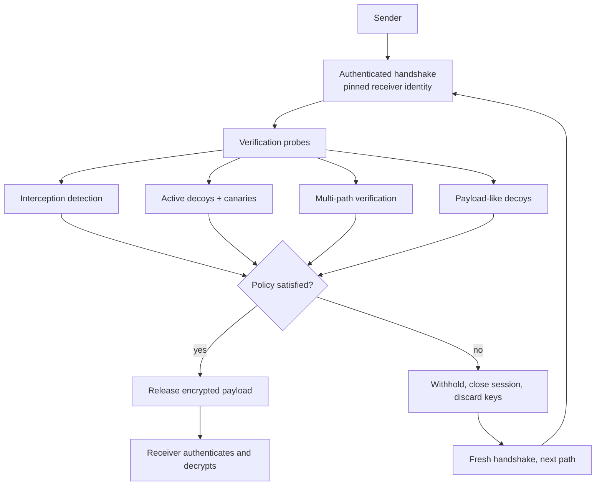

<div align="center">

# PathGuard

**Verify the path. Then release the payload.**

An experimental, open-source, decoy-assisted and authenticated data transmission protocol, written in Rust.

[](https://github.com/amalrn98/PathGuard/actions/workflows/ci.yml)
[](LICENSE)


</div>

> **Research prototype. Not audited. Do not use it to protect real secrets.**
> The cryptographic guarantees come from standard primitives (Ed25519, X25519, HKDF, ChaCha20-Poly1305). The decoy, canary and multi-path layers add detection signals and have **not** been shown to add real-world security. Measuring whether they do is the point of this project. See [Limitations](#limitations).

## The idea

Normal secure transports encrypt data and authenticate the peer, then send. They do not look at what the network is doing around the connection. PathGuard adds a verification phase **before** the payload leaves the sender:

1. Authenticate the receiver with a signed handshake pinned to its public identity.
2. Send probes (plain probes, bait that looks like credentials, payload-shaped encrypted decoys) over one or several paths.
3. Check the answers: MACs, duplicates, odd timing, canary touches, path diversity.
4. Release the encrypted payload only if a configurable policy is satisfied. Otherwise withhold it, discard the keys, and retry with a fresh handshake, starting from another path.



## The five mechanisms

Every mechanism is optional and switchable in a [policy file](policies/).

| | Mechanism | What it does | Evidence strength |
|---|---|---|---|
| A | Interception detection | Authenticated probes; flags bad MACs, rejected probes, duplicate replies, timing outliers | Strong for tampering, weak for timing and duplication |
| B | Active decoy attraction | Plaintext bait with canary tokens, watched through a honeypot | Only fires if an attacker takes the bait |
| C | Multi-path verification | Probes several paths; requires N verified paths with measured hop diversity | Diversity is only as good as the hop data you supply |
| D | Payload-like decoys | Encrypted decoys shaped like real traffic, keyed independently of the payload | Makes probe traffic hard to tell from payload by size and shape |
| E | Canary session invalidation | A canary trigger withholds the payload and kills the session | Indicator of exposure, not proof of interception |

## Try it

You need Rust 1.88 or newer.

```bash
git clone https://github.com/amalrn98/PathGuard.git
cd PathGuard
cargo run --release -- matrix
```

Result of running every built-in scenario under three policies (`baseline` is authenticated encryption with no probing):

```text
scenario                 baseline       balanced       paranoid      
--------------------------------------------------------------------
honest                   delivered      delivered      delivered     
lossy-link               delivered      delivered*     delivered*    
latency-spike            delivered      delivered*     delivered*    
mitm-all-paths           no-auth x3     no-auth x3     no-auth x3    
mitm-one-path            delivered x2*  delivered x2*  delivered x2* 
tamper-primary           unconfirmed    delivered x2*  delivered x2* 
tamper-secondary         delivered      delivered      delivered*    
forged-replies           delivered x2*  delivered x2*  delivered x2* 
duplicate-replies        delivered      delivered x2*  delivered x2* 
snooping-primary         delivered      delivered x2*  withheld x3   
snooping-secondary       delivered      delivered      withheld x3   
passive-relay            delivered      delivered      delivered     
shared-infrastructure    delivered      delivered      withheld x3   

xN = succeeded or ended after N attempts (fresh handshake and keys each time)
*  = delivered, but findings were recorded (alerts raised)
payload plaintext ever visible to an on-path observer: false
```

How to read it:

* `mitm-all-paths`: an attacker that impersonates the receiver is never accepted, under any policy. This is the cryptographic handshake doing its job.
* `tamper-primary`: with `baseline` the tampered payload is sent and rejected by the receiver. With probing it is never sent, and a clean path is used on the next attempt.
* `passive-relay`: delivered under every policy. A relay that forwards everything verbatim cannot be told apart from a slow honest path. The attacker still learns nothing, because only the authenticated receiver holds the keys. This is a documented, expected result, not a bug.
* `shared-infrastructure`: three paths that share the same hops fail the diversity requirement of `paranoid`.

Walk through one scenario with the full audit trail:

```bash
cargo run -- demo --scenario tamper-primary --policy paranoid
cargo run -- scenarios            # list all scenarios
cargo run -- policy paranoid      # print a policy as TOML
cargo run --example basic
```

## Use it as a library

```rust
use pathguard::sim::World;
use pathguard::Policy;

let world = World::new();                       // simulated network, sender and receiver
let sender = world.sender(Policy::balanced());
let mut paths = vec![world.honest_path("p1", &["isp-a", "ix-1"], 1)];

let report = sender.send(b"hello", &mut paths)?;
assert!(report.delivered);
println!("{}", report.render());                // full audit trail
```

To use real networks, implement the [`Path`](src/path.rs) trait (one request/response route to the receiver) and run a [`Receiver`](src/receiver.rs) behind your transport. Real transports (QUIC, UDP) are on the [roadmap](docs/ROADMAP.md).

## Policy

```toml
name = "paranoid"

[mechanisms]
interception_detection = true
active_decoys = true
multipath = true
payload_like_decoys = true
canary = true

[verification]
probes_per_path = 4
min_verified_paths = 2
min_path_diversity = 0.5
tolerate_failed_secondary_paths = true

[failure]
max_retries = 2
close_session_on_failure = true
```

Presets live in [`policies/`](policies/). Unknown keys are rejected, values are validated, and every decision is written to an audit log.

## Limitations

Read these before drawing any conclusion from this project.

* **No decoy can prove a path is clean.** A relay attacker can forward probes to the real receiver and forward the answers back. PathGuard relies on endpoint authentication and keys for security, and treats route changes as normal, not as compromise.
* **Detection signals are evidence, not verdicts.** Timing and duplication are weak. Canaries only fire if someone touches them.
* **Path diversity is an input, not a discovery.** You supply hop identifiers (ASNs, routers). Wrong data gives a wrong diversity score. Unknown hops count as no diversity.
* **Simulation only.** The current results come from a deterministic in-memory simulator. No real-network measurements exist yet.
* **Not implemented yet:** traffic padding and timing obfuscation, real transports, post-quantum key establishment, Noise or TLS 1.3 integration, an independent audit. See the [threat model](docs/THREAT_MODEL.md).

## Repository layout

```text
src/
  crypto.rs      Ed25519, X25519, HKDF, HMAC, ChaCha20-Poly1305 wrappers
  handshake.rs   signed hello and ack transcripts
  message.rs     wire format (bounded, panic-free decoding)
  sender.rs      verify, decide, release; retries with fresh keys
  receiver.rs    session state, replay protection, authenticated replies
  detect.rs      findings, severities, RTT baselines
  canary.rs      canary tokens and the honeypot
  multipath.rs   path diversity
  policy.rs      TOML policy, presets, validation
  path.rs        transport trait
  sim.rs         deterministic network and adversary simulator
  main.rs        CLI
tests/           protocol properties and the scenario matrix
docs/            protocol spec, threat model, architecture, evaluation, roadmap
policies/        example policies
```

## Documentation

* [Protocol specification](docs/PROTOCOL.md)
* [Threat model](docs/THREAT_MODEL.md)
* [Architecture](docs/ARCHITECTURE.md)
* [Evaluation plan and current results](docs/EVALUATION.md)
* [Roadmap](docs/ROADMAP.md)
* [Original proposal](docs/PROPOSAL.md)

## Contributing

Contributions are welcome, especially adversarial ones: new attack scenarios, protocol review, and real-network measurements. Start with [CONTRIBUTING.md](CONTRIBUTING.md). Security reports go through [SECURITY.md](SECURITY.md). Everyone is expected to follow the [Code of Conduct](CODE_OF_CONDUCT.md). You can reach the maintainer on Discord at **@mythicavalon**.

## License

Apache-2.0. See [LICENSE](LICENSE) and [NOTICE](NOTICE).
